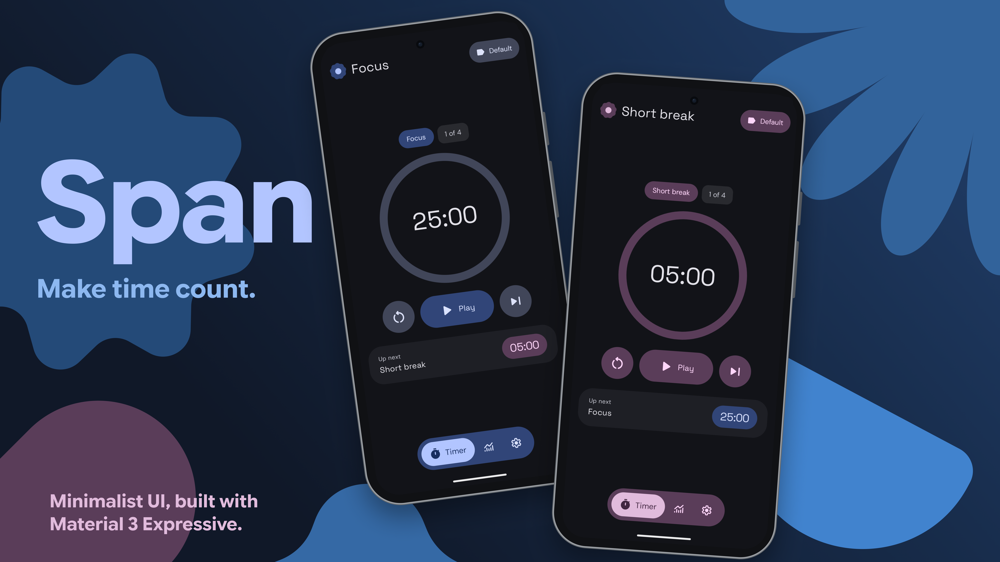
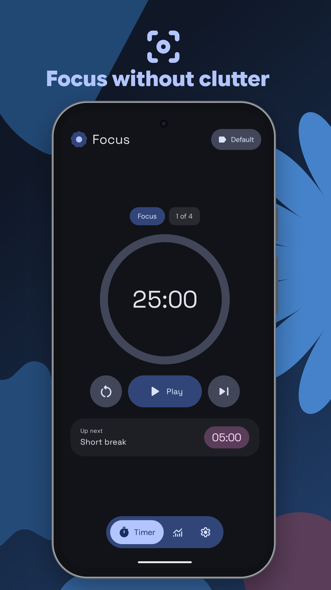
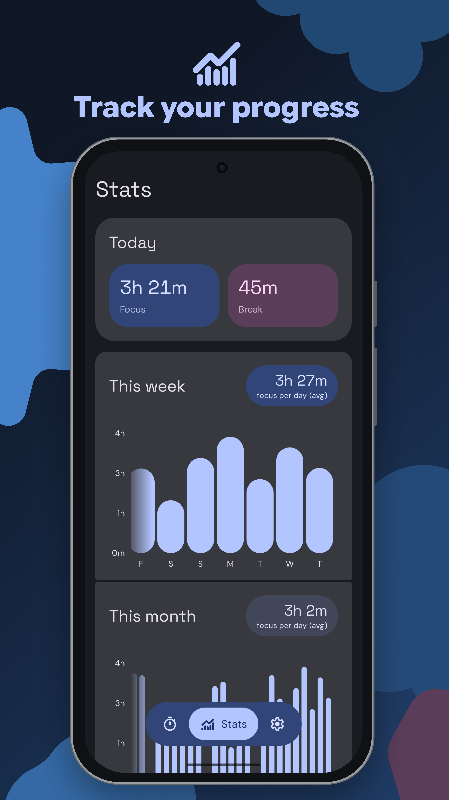
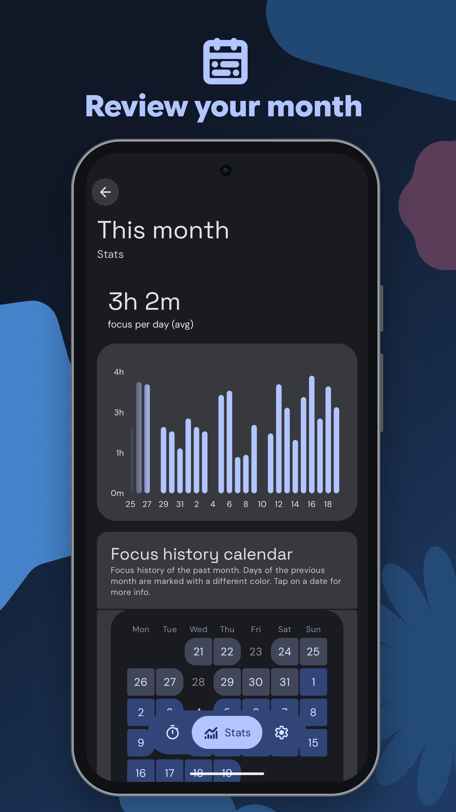
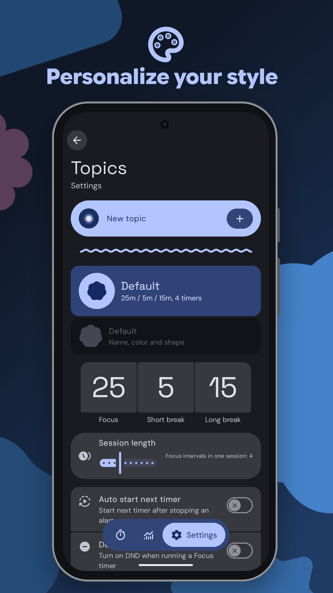
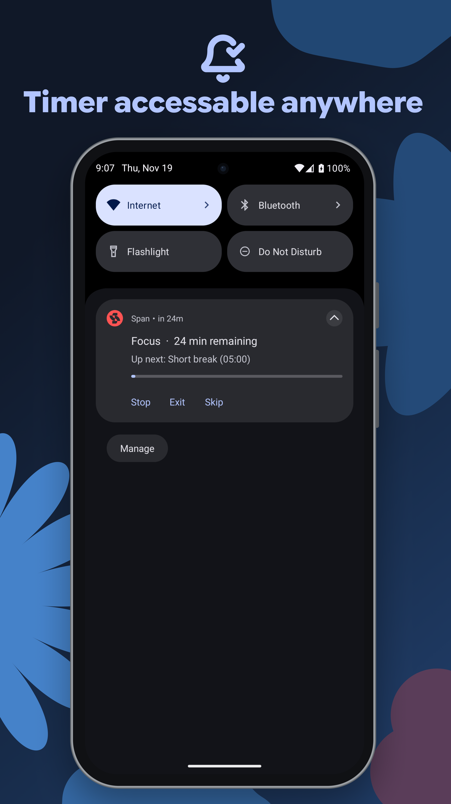

# Span

**Focus your time. Understand your progress.**

Span is a minimalist Pomodoro timer for Android, built to make focused work simple and help you understand how you spend your time.

## Screenshots

| | | |
|:---:|:---:|:---:|
|  |  |  |
|  |  |  |

## Features

- **Minimalist Design** — Material Design 3 Expressive with dynamic wallpaper colors and custom color schemes.
- **Customizable Timer** — Configure focus, short-break, and long-break durations.
- **Topics** — Keep separate timer configurations and color schemes for different activities.
- **Focus Statistics** — Track daily, weekly, monthly, and lifetime focus time with detailed history and visualizations.
- **AMOLED Standby** — A distraction-free black timer display.
- **Alarm Controls** — Customize alarm duration, intervals, headphone mode, and vibration patterns.
- **Android Integrations** — Home-screen widgets, Quick Settings Tile, and Always On Display support.

## Built With

- [Kotlin Multiplatform](https://kotlinlang.org/docs/multiplatform.html)
- [Compose Multiplatform](https://www.jetbrains.com/compose-multiplatform/)
- [Room](https://developer.android.com/training/data-storage/room)
- [Koin](https://insert-koin.io/)
- [MaterialKolor](https://github.com/jordond/MaterialKolor)
- [Vico](https://github.com/patrykandpatrick/vico)

## Support

If Span has been useful to you, consider giving this repository a ⭐ **star**. It helps the project reach more people and supports its continued development.

You can also visit my [GitHub profile](https://github.com/erroraxiom) to explore my other projects and find my social links. You can find my contact and social links in Span's **About** section as well.

## License

Span is open source under the [GNU General Public License v3.0](LICENSE).

---

**Made with Kotlin by [erroraxiom](https://github.com/erroraxiom).**
