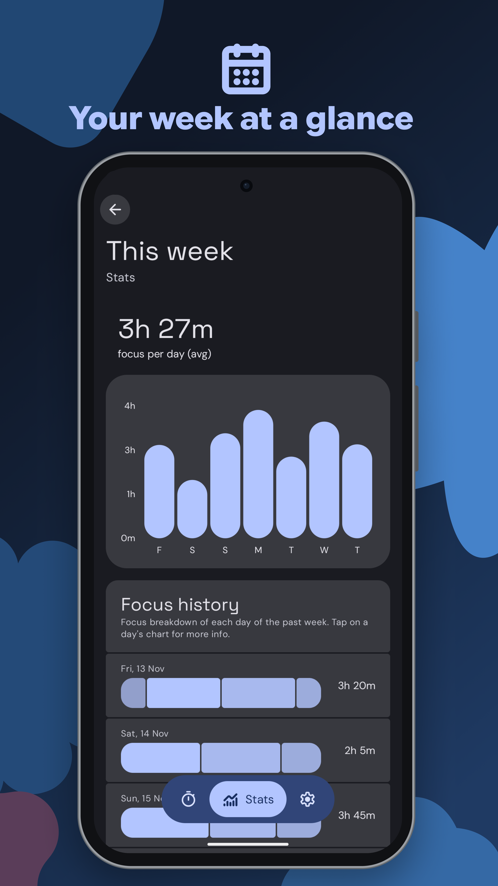

# Span

\<p align="center">
&#x20; \<strong>Focus your time. Understand your progress.\</strong>
&#x20; \<br />
&#x20; A feature-rich, minimalist Pomodoro timer for Android.
&#x20; \<br />\<br />
&#x20; \
&#x20; \
&#x20; \
&#x20; \
\</p>

---

## Preview

\<p align="center">   \   \   \ \</p>

\<p align="center">   \   \ \</p>

---

## About Span

**Span** is a minimalist, feature-rich Pomodoro timer designed to help you manage focused work sessions, organize different activities, and understand how you spend your time.

It brings together customizable focus and break intervals, topic-based timer configurations, detailed productivity statistics, and extensive alarm settings in a clean interface built with **Material Design 3 Expressive**.

Whether you're studying, working, or building something, Span gives you the flexibility to configure your sessions and the tools to keep track of your progress.

## Features

### ⏱️ Customizable Timer

Configure your focus sessions and breaks according to your preferences.

- Customizable focus duration.
- Customizable short-break duration.
- Customizable long-break duration.
- Automatic next-session behavior.
- Background timer functionality.
- Customizable alarm and vibration settings.

### 🎯 Topics

Topics let you maintain different timer configurations for different activities.

Create a topic and save its own configuration. When you switch topics, Span automatically applies the associated settings.

Each topic can have its own:

- Focus, short-break, and long-break durations.
- Color scheme and appearance.

You can also configure whether Span automatically starts the next focus or break session.

*Some global settings, such as alarm preferences and language, remain independent of individual topics.*

### 📊 Detailed Statistics

Understand your focus habits through three dedicated statistics views.

**Today**

- Total focus time.
- Number of focus sessions.
- Number of breaks taken.

**This Week**

- Complete focus history.
- Focus breakdown.
- Focus-to-break ratio.

**This Month**

- Calendar-based focus history.
- Monthly focus breakdown.
- Focus-to-break ratio.

**Lifetime Focus**

Keep track of the total amount of time you've spent focusing in Span throughout your usage.

### 🎨 Personalization

A clean, expressive interface with flexible color customization.

- Material Design 3 Expressive.
- Dynamic colors based on your device wallpaper.
- Customizable color schemes.
- Topic-specific color schemes.
- AMOLED black standby mode.

### 🌑 AMOLED Standby Mode

Turn your timer screen into a minimal, distraction-free display.

Enable AMOLED mode from Timer Settings, then tap the blank area of the timer screen to activate it.

The display turns completely black, keeping only the timer visible. It's designed for situations where you want to check your remaining time without keeping the entire interface illuminated.

### 🔔 Alarm & Notifications

Configure how Span handles session alarms.

- Adjustable alarm duration.
- Configurable alarm gap.
- Headphone mode.
- Customizable vibration patterns.

### 📱 Android Integrations

- Always On Display (AOD) support.
- Quick Settings Tile.
- Home-screen widgets:
  - Timer
  - Today's statistics
  - Focus history

## Settings

Span provides dedicated settings for managing your timer experience.

| Setting        | What you can configure                                  |
| -------------- | ------------------------------------------------------- |
| Timer Settings | Focus and break durations, AMOLED mode                  |
| Topic Settings | Create and manage topics, automatic session behavior    |
| Alarm Settings | Alarm duration, gap, headphone mode, vibration patterns |
| About          | App information, developer links, and license           |

## Technology Stack

Span is built using Kotlin and modern declarative UI technologies.

| Technology                   | Purpose                       |
| ---------------------------- | ----------------------------- |
| Kotlin Multiplatform         | Shared application logic      |
| Compose Multiplatform        | Declarative UI                |
| Material Design 3 Expressive | UI design system              |
| Room                         | Local database persistence    |
| Koin                         | Dependency injection          |
| MaterialKolor                | Dynamic color generation      |
| Vico                         | Charts and data visualization |

## Getting Started

### Prerequisites

- Android Studio
- JDK 17 or newer
- Android SDK

### Build from Source

1. Clone the repository:

   ```bash
   git clone https://github.com/erroraxiom/Span.git
   ```

2. Open the project in Android Studio.

3. Allow Gradle to sync and resolve the dependencies.

4. Run the Android application on an emulator or a connected Android device.

Alternatively, build a debug APK from the project root:

```bash
./gradlew :app:assembleDebug
```

## Support the Developer

If you enjoy using Span, consider supporting its development.

- Follow the developer on the social platforms linked in the app's **About** section.
- Visit the [developer's GitHub profile](https://github.com/erroraxiom) to explore other projects and find more social links.
- If Span has been helpful to you in any way, consider giving this repository a ⭐ **Star**. It helps the project gain visibility and supports its continued development.
- Share Span with others who might find it useful.

Your support and feedback are appreciated.

## Open Source License

Span is open source and distributed under the **GNU General Public License v3.0 (GPL-3.0)**.

You can find the complete license in the [LICENSE](LICENSE) file.

---

\<p align="center">
&#x20; \<strong>Span\</strong>
&#x20; \<br />
&#x20; Focus with intention.
&#x20; \<br />\<br />
&#x20; Developed by \<a href="[https://github.com/erroraxiom](https://github.com/erroraxiom)">erroraxiom\</a>
\</p>
